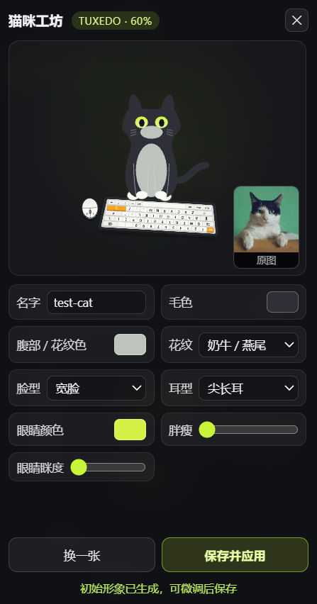
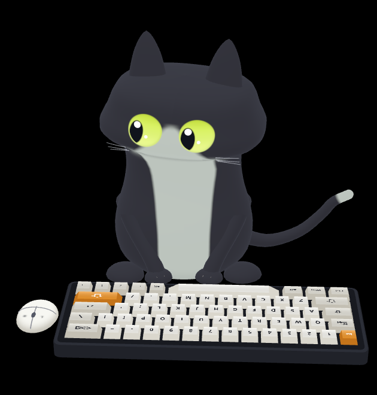

> **KuroCat Photo Studio** — a derivative of [qianyiai/kurocat](https://github.com/qianyiai/kurocat) (MIT,
> Copyright © 2026 KuroCat Contributors) that adds a photo → cat-appearance feature.
> 中文说明见 [README.md](README.md)；原创署名与差异清单见 [NOTICE.md](NOTICE.md)。

# KuroCat Photo Studio

> Pick a photo of a cat. It moves onto your desktop — 2D and 3D, the same cat.

This repository keeps the **entire upstream codebase** and adds one capability: turn any cat photo into the
desktop pet's appearance. Upstream project, license and authorship are recorded in [NOTICE.md](NOTICE.md).

---

## What it is

A transparent, always-on-top desktop cat that types along with your AI coding assistant — Claude Code, Codex,
DeepSeek Harness and similar — and reports state (working / waiting / error / done) through speech bubbles.
Two renderers ship with it: a six-degree-of-freedom 3D cat (three.js) and a 2D canvas cat.

**Added here**: photo → appearance.

| Where | What happens |
| --- | --- |
| Right-click the cat → *Appearance* → `📷 Create my cat from a photo` | Opens the Cat Studio |
| Pick a local image | Local analysis extracts fur colour, pattern, face, ears, eye colour |
| Live 2D preview + 8 knobs | fur, belly colour, pattern, face shape, ear shape, eye colour, chubbiness, eye squint |
| *Save and apply* | Stored as a custom cat, applied immediately to both renderers |

<p align="center">
  
  
</p>

---

## How the photo is understood

Everything runs **locally in the frontend** — no network, no upload, no cloud vision API:

1. downscale to 168 px on the long side, read every pixel;
2. cluster into 6 representative colours (deterministic k-means, farthest-point seeding, 14 iterations);
3. reject the background using the **outer 15 % ring** of the frame rather than four corner samples — a green
   wall behind the cat no longer leaks into the fur colour;
4. from the remaining subject decide the pattern (solid / bicolor / tuxedo / tabby / calico / siamese),
   eye colour and nose colour;
5. infer face shape, ear shape and chubbiness from silhouette aspect ratio and top-band width;
6. emit a `CatSkinConfig` and hand it to the existing renderers.

It is a *parameterised replica*, not a photo texture: the generated cat still animates, types, and reacts to task
state. New code lives in `src/photoCat.ts` (analysis) and `src/catStudio.ts` (panel + preview). Rust only gained
two commands (`save_custom_cat`, `set_cat_studio_open`) and a `studio_open` guard so the native file dialog
cannot hide the side menu through the existing focus-lost handler.

---

## Platforms

| Platform | Status | Notes |
| --- | --- | --- |
| Windows 10 / 11 (x64) | ✅ verified on hardware | Built, installed, run and uninstalled on Windows 11 + WebView2 |
| macOS 10.15+ (Intel / Apple Silicon) | ✅ Universal `.dmg` published by CI (ad hoc signature) | see below; not hand-tested on a Mac |
| Linux (webkit2gtk) | ✅ AppImage + deb published by CI | upstream supports it; this feature has no platform-specific code |

### macOS install note

The published `.dmg` is **ad hoc signed** (no Apple Developer certificate), so Gatekeeper blocks the first launch
with "cannot verify the developer". Open it either way:

1. right-click KuroCat in `Applications` → **Open** → **Open** again, or
2. run `xattr -dr com.apple.quarantine /Applications/KuroCat.app` and then double-click.

This only affects the very first launch.

Why macOS is expected to work: the added Rust code uses only `std` and public Tauri APIs, with no
`windows-sys` / `objc2` / `cfg` branches; the frontend uses standard Canvas 2D, `File`, `Image` and
`@tauri-apps/api`. The one real platform trap is `createImageBitmap(Blob)`, which WKWebView only gained in
Safari 15 while `tauri.conf.json` targets macOS 10.15 — so decoding now tries `createImageBitmap` first and falls
back to `URL.createObjectURL` + `` + `onload` before drawing into the canvas (`loadPhoto()` in
`src/catStudio.ts`). Upstream already ships `icon.icns`, `bundle.targets = "all"` and
`macOS.minimumSystemVersion = "10.15"`.

Quick self-check on a Mac:

```bash
npm install
npm run build
npm run tauri:dev   # Appearance → Create my cat from a photo → pick a jpg/png
```

---

## Differences from upstream

Added: `src/photoCat.ts`, `src/catStudio.ts`, `docs/screenshots/*`, `NOTICE.md`, rewritten `README.md`, this file.

Changed: `menu.html` (entry button + panel markup), `src/style.css` (panel styles), `src/menuMain.ts`
(initialisation, click handling, Escape order), `src-tauri/src/lib.rs` (two commands + focus guard),
`locales/{zh-CN,zh-TW,en-US,ja-JP,ko-KR}.json` (38 strings each), `package.json` (metadata only).

Everything else — interaction, settings, MCP/hook integration, renderers — is untouched.

Note on naming: the installed binary keeps upstream's product name `KuroCat` and identifier `com.kurocat.pet`
so it stays a drop-in upgrade; the project name *KuroCat Photo Studio* is used for the repository and docs.

---

## Build from source

Requirements: Node 18+, Rust stable, Tauri 2 system dependencies (Windows: WebView2 + MSVC build tools).

```bash
npm ci
npm run build          # tsc + vite
npm run tauri:build    # executable + installer under src-tauri/target/release/bundle/
```

### Behind a restricted network

`npm run tauri:build` bundles an **MSI** by default, which makes Tauri download WiX from
`github.com/wixtoolset/wix3`. If GitHub is unreachable the bundle step fails with
`failed to bundle project: timeout: global` *after* `KuroCat.exe` has already been produced. Two workarounds:

```powershell
$env:TAURI_BUNDLER_TOOLS_GITHUB_MIRROR = "https://gh-proxy.com/https://github.com"
npm run tauri:build -- --bundles nsis   # NSIS only: no WiX, smaller installer
```

Use `npm ci --registry=https://registry.npmmirror.com` if npm is slow, and a sparse crates.io mirror
(e.g. `https://rsproxy.cn`) in `%USERPROFILE%\.cargo\config.toml` — keep exactly **one** `[source.*]`
replacement, otherwise cargo reports `already defined`.

### Running two builds side by side

Only one instance per user is allowed (`Local\KuroCat.SingleInstance.Mutex`); a second launch hands over to the
running instance and exits. To test another build in parallel, set both `WEBVIEW2_USER_DATA_FOLDER` and `APPDATA`
to separate directories, otherwise the two processes fight over the same WebView2 profile and fail with
`WebView2 error: 0x800700AA` ("the requested resource is in use").

---

## Known limitations

1. When the background colour is close to the fur, ring clustering can still absorb some background — fix it with
   the fur colour control;
2. tabby striping and colour-points are heuristic and may come out as solid or bicolor — switch the pattern
   dropdown, which backfills stripe/spot colours;
3. only the static look is inferred: stripe layout is generated by rules (max 16 spots);
4. this is inference, not understanding: no pose, breed or expression recognition.

---

## License

MIT — see [LICENSE](LICENSE). Upstream copyright belongs to KuroCat Contributors; this repository's
modifications are released under the same license.