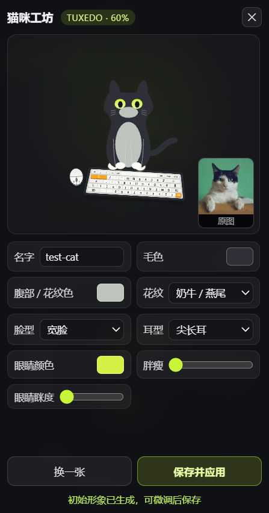
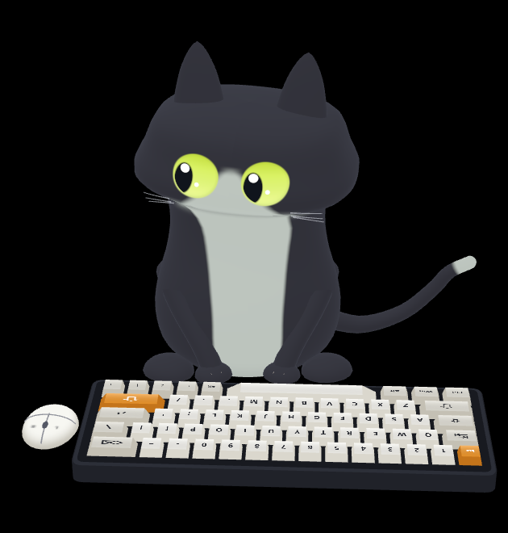
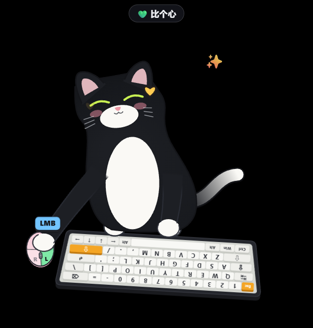
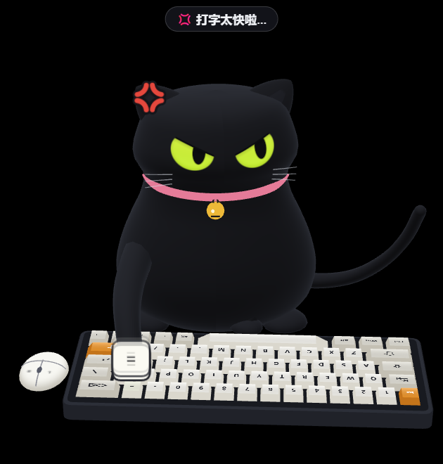
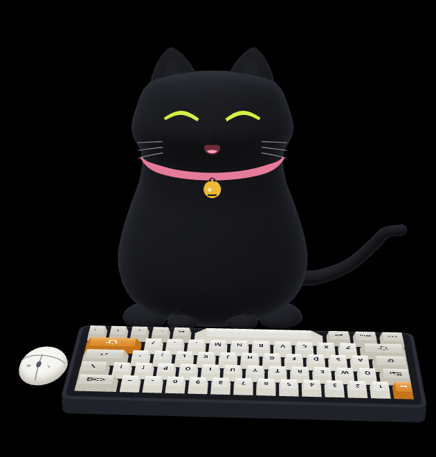
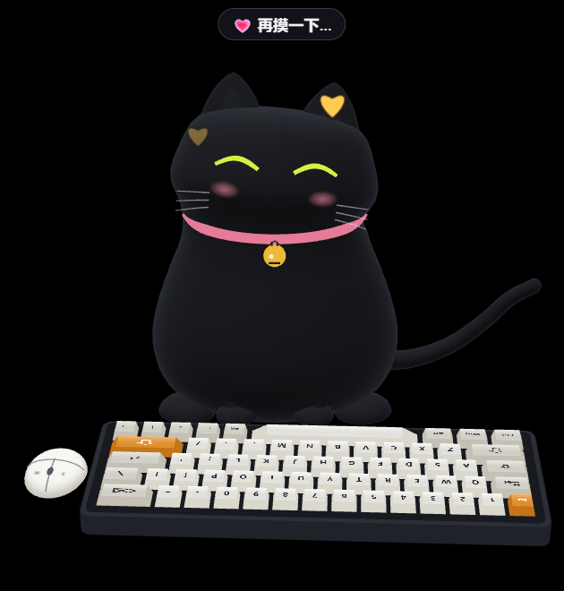

# KuroCat Photo Studio · 黑猫照相馆

> 选一张猫咪照片，它就会坐到你桌面上 —— 2D 和 3D 都是同一只。

**项目主页：<https://quark10086.github.io/kurocat-photo-studio/>** ·
**下载：<https://github.com/quark10086/kurocat-photo-studio/releases/latest>**

**这是一个衍生项目（derivative work）。** 上游原创项目是
[qianyiai/kurocat](https://github.com/qianyiai/kurocat)（MIT，Copyright © 2026 KuroCat Contributors）。
本仓库在完整保留上游代码的基础上，新增了「从图片创建我的猫」能力，并把说明改成以新功能为中心。
原创署名、许可文本与差异清单见 [NOTICE.md](NOTICE.md)。

---

## 它是什么

一个常驻桌面的透明桌宠猫：会跟着你的 AI 编码助手（Claude Code / Codex / DeepSeek Harness 等）的进度敲键盘、
冒气泡、报告「工作中 / 等待确认 / 出错 / 完成」。支持 3D（three.js）与 2D（Canvas）两套渲染，一键切换。

**本项目新增**：把任意一张猫咪照片变成这只猫的外观。

| 入口 | 效果 |
| --- | --- |
| 右键猫咪 →「角色外观」→ `📷 从图片创建我的猫` | 打开「猫咪工坊」 |
| 选择本地照片 | 本地分析出毛色 / 花纹 / 脸型 / 耳型 / 眼睛颜色 |
| 实时 2D 预览 + 8 项微调 | 毛色、腹部花纹色、花纹类型、脸型、耳型、眼睛颜色、胖瘦、眼睛眯度 |
| 「保存并应用」 | 写入自定义猫列表、立即换装，2D 与 3D 同时生效 |

<p align="center">
  
  
</p>

---

## v5.3 新增

| 能力 | 说明 |
| --- | --- |
| 双猫交接 | 换猫时两只猫同屏演出：旧猫从左侧滑入致意再退场，新猫右侧接岗，画面整体右移让位；四种风格随机（🫡 致意+✨ / 💢 哈气 / 💤 不理 / 💗 比爱心），3.2 秒，3D 状态播完自动恢复 |
| 打字抗议 | 连续打字 25 秒（停顿 >1.2 秒算中断）→ 眼睛变凶、抬爪离键、💢 + 温和低音抗议；冷却 3 分钟 |
| 困了打哈欠 | 键鼠 90 秒无动作 → 眯眼张嘴打哈欠，配吸气与叹气的合成音 |
| 被摸会开心 | 光标在猫身上停留 1.5 秒 → 蹭手心、爱心飘起，配满足的呼噜与轻哼；6 秒一次 |
| 音效零素材 | 三种新音效全部 WebAudio 现场合成（振荡器 / 噪声 / 滤波 / 包络），不打包音频文件 |

以上互动在「声音开关关闭」「隐私模式（输密码）」「游戏模式」下自动静默。

| 双猫交接 | 打字抗议 | 打哈欠 | 摸猫爱心 |
| --- | --- | --- | --- |
|  |  |  |  |

---

## v5.2 系列新增

上一版只做「照片 → 猫」。这一版把自定义与互动补齐了：

> 说明：v5.2.0 曾试做「蛇 / 鸡」两套 2D 形体，因动作与比例不达预期，已在后续版本**整体移除**（源码、界面入口、内置数据都已删干净）。现在角色外观只保留猫系 + 大肥鱼。

| 能力 | 说明 |
| --- | --- |
| 识图更准 | 除了整体毛色，还按头部 / 躯干 / 腹部 / 四肢 / 尾巴五个部位分别取色；并给出 8 个品种候选（中华田园、橘猫、奶牛、三花、英短蓝、美短银渐层、布偶、暹罗）及匹配度，点一下就套用该品种的配色与脸型 |
| 颜色自定义 | 工坊分「简易 / 高级」两档；高级里按耳朵、头部、四肢、尾巴、躯干分五组，可以改耳内 / 耳外 / 耳尖、面罩 / 鼻梁 / 胡须、手臂 / 爪子、尾巴 / 尾尖、侧腹 / 腹部 / 条纹 / 斑块 |
| 换岗动效 | 换猫时随机播一个：敬礼、互相哈气、谁也不理谁、比爱心，由同一套 2D 引擎画两只猫同屏，配一句气泡；结束后自动回到原本的渲染模式 |
| 键盘阵列 | 65% 紧凑、75% 便携、87 TKL、108 全尺寸四种，2D 与 3D 同步，窗口尺寸自动跟着变 |
| 鼠标样式 | 8 款（经典白、曜石黑、樱花粉、薄荷绿、电光紫、奶茶棕、冰川蓝、余烬橙），按「猫 id + 随机种子」分配，每只猫天生一样；设置里 🎲 可重掷 |
| 角色外观 | 内置 7 只猫（经典小黑猫、奶茶布偶、大橘猫、三花、奶牛、奶油猫、暹罗）+ 大肥鱼；自己生成的形象也会进这个列表 |

---
## 新功能怎么用

1. 右键点击桌面上的猫，在菜单里选 **角色外观**；
2. 点猫形列表下方的 **📷 从图片创建我的猫**，会弹出系统选图对话框；
3. 选一张照片。建议：猫占画面主体、背景相对干净、正面或半侧面最好；
4. 「猫咪工坊」会给出初始形象与置信度角标，不满意就调那 8 个控件；
5. 点 **保存并应用** —— 它会成为角色列表里的一只新猫，随时可切回内置的 7 只。

生成的是「参数化复刻」：不会把照片贴成贴图，而是把照片推断成一整套外观参数，再由原有的 2D/3D 引擎画出来。
因此换装后它仍然会动、会敲键盘、会被任务状态驱动。

---

## 图片是怎样被理解的

全部在**本地前端**完成，不联网、不上传、不调用任何云端视觉 API：

1. 把图片缩到 168px 长边，读取全部像素；
2. 取 6 类代表色（确定性 k-means，最远点初始化，固定 14 轮）；
3. 用「画面外圈 15% 边缘带」判定背景色并剔除（比单纯采样四角更稳，绿色墙壁这类大片背景不会再串成毛色）；
4. 由剩下主体的色调、明度、饱和度决定花纹（纯色 / 双色 / 奶牛 / 虎斑 / 三花 / 重点色）、眼睛颜色、鼻子颜色；
5. 由主体轮廓的宽高比与顶部宽度推断脸型、耳型、胖瘦；
6. 输出一份 `CatSkinConfig`，交给现有的渲染引擎。

新增代码：`src/photoCat.ts`（分析与推断）、`src/catStudio.ts`（工坊面板与预览）、`src/catBreeds.ts`（8 品种预设与匹配打分）、`src/mouseStyles.ts`（鼠标配色）。
Rust 侧只加了两个 Tauri 命令（`save_custom_cat`、`set_cat_studio_open`）和一个「工坊打开中」的保护标志，
用来防止系统选图对话框抢走焦点时侧边菜单按原有逻辑自动隐藏。

---

## 平台支持

| 平台 | 状态 | 说明 |
| --- | --- | --- |
| Windows 10 / 11 (x64) | ✅ 已实机跑通 | 本仓库的构建与全部截图都在 Windows 11 + WebView2 上完成；Release 里的安装包实测可装、可跑、可卸 |
| macOS 10.15+ (Intel / Apple Silicon) | ✅ 官方 CI 已产出 Universal 安装包（ad hoc 签名） | 见下方「跨平台确认」与「macOS 安装提示」；未在真机上人工点过 |
| Linux (webkit2gtk) | ✅ CI 已产出 AppImage + deb | 上游支持，本功能无平台相关代码 |

### macOS 安装提示

Release 里的 `.dmg` 是 **ad hoc 签名**（没有 Apple 开发者证书），首次打开会被 Gatekeeper 拦下，
提示「无法验证开发者」。两种正常打开方式：

1. 在 `应用程序` 里右键点 KuroCat → 选择「打开」→ 再点一次「打开」；
2. 或者执行 `xattr -dr com.apple.quarantine /Applications/KuroCat.app` 后再双击。

这不影响功能，只影响首次启动的那一次确认。

### 跨平台确认（说明依据，不夸大）

新增代码里没有任何平台绑定：

- Rust 侧只用到 `std` 与 Tauri 公共 API（`Arc<AtomicBool>`、`WindowEvent::Focused`、两个普通 command），
  没有 `windows-sys` / `objc2` / 条件编译；
- 前端只用标准 Canvas 2D、`File`、`Image` 与 `@tauri-apps/api`；
- 唯一与平台相关的坑是 `createImageBitmap(Blob)`：WKWebView 直到 Safari 15 才提供它，而 `tauri.conf.json`
  声明的最低系统是 macOS 10.15。所以解码走两级回退 —— 先试 `createImageBitmap`，不可用或抛错就退回
  `URL.createObjectURL` + `` + `onload`，再画进 canvas（`src/catStudio.ts` 的 `loadPhoto()`）；
- 上游原本就有 `icon.icns`、`bundle.targets = "all"`、`macOS.minimumSystemVersion = "10.15"`，无需改动。

在 macOS 上自检的最短路径：

```bash
npm install
npm run build
npm run tauri:dev     # 打开菜单 → 角色外观 → 从图片创建我的猫，选一张 jpg/png
```

如果选图后能出预览、保存后猫换装，就说明这条链路在 macOS 上通了。
想直接出安装包用 `npm run tauri:build`（产物在 `src-tauri/target/release/bundle/`）。

---

## 与上游的差异

新增：`src/photoCat.ts`、`src/catStudio.ts`、`docs/screenshots/*`、`NOTICE.md`、本 README。

修改：`menu.html`（入口按钮 + 工坊面板）、`src/style.css`（工坊样式）、`src/menuMain.ts`（初始化与按键处理）、
`src-tauri/src/lib.rs`（两个命令 + 焦点保护标志）、`locales/{zh-CN,zh-TW,en-US,ja-JP,ko-KR}.json`（各 38 条文案）。

行为差异：除新增入口外，原有交互、设置项、MCP/钩子联动与渲染逻辑均未改动。

---

## 从源码构建

前置：Node 18+、Rust stable、Tauri 2 对应平台的系统依赖（Windows 需 WebView2 与 MSVC Build Tools）。

```bash
npm ci
npm run build          # tsc + vite
npm run tauri:build    # 产出可执行文件与安装包
```

### 网络受限时（中国大陆常见）

`npm run tauri:build` 默认会打包 **MSI**，需要 Tauri 从 `github.com/wixtoolset/wix3` 下载 WiX；如果 GitHub
不可达，会在 Rust 编译成功之后以 `failed to bundle project: timeout: global` 失败（此时 `KuroCat.exe`
其实已经生成）。两个可用的绕法：

```powershell
# 1) 让 Tauri 的打包工具走镜像
$env:TAURI_BUNDLER_TOOLS_GITHUB_MIRROR = "https://gh-proxy.com/https://github.com"

# 2) 只出 NSIS 安装包（不走 WiX，体积也更小）
npm run tauri:build -- --bundles nsis
```

npm 依赖慢时用 `npm ci --registry=https://registry.npmmirror.com`。Rust 依赖慢时在
`%USERPROFILE%\.cargo\config.toml` 里把 crates.io 换成 sparse 镜像（例如 `https://rsproxy.cn`），
注意**只能保留一个** `[source.*]` 替换项，否则 cargo 会报 `already defined`。

### 本地跑起来注意

同一个用户下只能有一个实例（`Local\KuroCat.SingleInstance.Mutex`）：第二次启动会把窗口交给已有实例后直接退出。
如果要并行测试另一个构建，请同时指定 `WEBVIEW2_USER_DATA_FOLDER` 与 `APPDATA` 两个环境变量，
否则两个进程会争用同一个 WebView2 配置目录，报 `WebView2 error: 0x800700AA`（请求的资源在使用中）。

---

## 已知局限（如实说明）

1. 背景与猫毛颜色接近时，边缘聚类仍可能把背景算进主体，导致毛色偏色 —— 用「毛色」控件改一下即可；
2. 虎斑条纹、重点色是启发式判断，可能被识别成纯色或双色 —— 用「花纹」下拉框切换，切过去会自动补上条纹/斑块颜色；
3. 只推断「静态外观」，不识别花纹的具体走向与位置（斑块由规则生成，上限 16 个）；
4. 这是「就地推断」，不是「看懂照片」：没有姿态与表情识别。品种只给出**候选与匹配度**（8 选 3），由你点选确认，不是硬判定；

---

## English

**KuroCat Photo Studio** turns a photo of a cat into the desktop pet's appearance.
It is a derivative of [qianyiai/kurocat](https://github.com/qianyiai/kurocat) (MIT), keeping the whole upstream
codebase and adding a local, offline photo-to-appearance pipeline (Canvas 2D + k-means colour clustering +
ring-band background rejection). Generated parameters drive both the 2D and the 3D renderer. Windows is verified;
macOS is supported at the code level (`createImageBitmap` has an `` fallback for older WebKit).

---

## 许可

MIT，见 [LICENSE](LICENSE)。上游版权归 KuroCat Contributors；本仓库的修改同样以 MIT 发布。